# FurSight

**Spoil them. Worry less.** One pet care assistant on Meta Quest, your phone, smart glasses (Meta Ray-Ban Display) and the web. **Muse Spark** is the agent, **SAM 3.1** is the finder, and **Muse Voice Transcribe** hears you, all through the Meta Model API.

> **Try it now, no key or login:** open **[fursight-seven.vercel.app](https://fursight-seven.vercel.app)** and press **Try it with a demo rabbit**. Then tap **Ask** → "How is he today?" to watch Muse Spark find him on the pet cams with SAM 3.1.

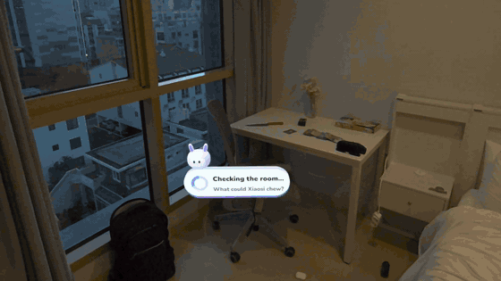

*Room check on Quest, the room remembering it next time, a food check on the glasses, a meal check on the phone, his week on Quest.*

Watch: **[the 3-minute film on YouTube](https://youtu.be/5Krj1QjiIVM)** · [the film in your browser](https://fursight-seven.vercel.app/film/) · [the intro](https://fursight-seven.vercel.app/intro/) · [how it uses Meta's models](https://fursight-seven.vercel.app/muse/) · [the kit](https://fursight-seven.vercel.app/kit/)

### Short clips

| [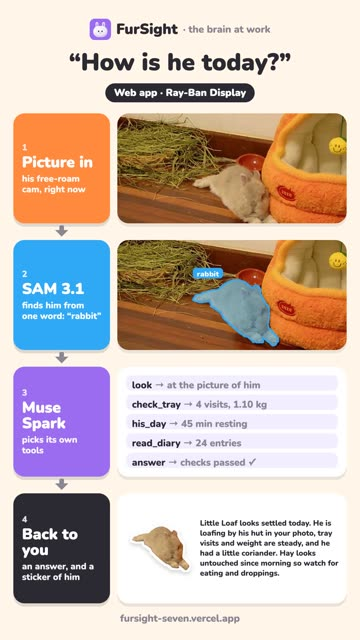](docs/videos/how-fursight-thinks.mp4) | [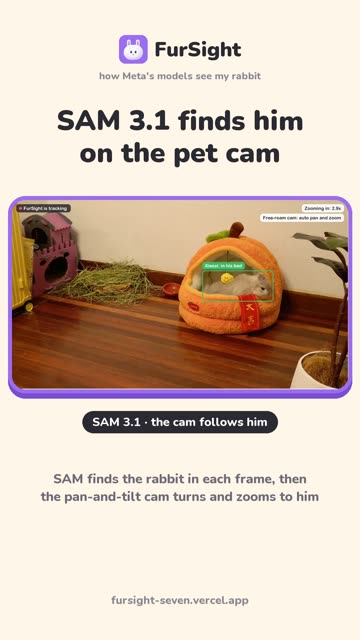](docs/videos/meta-models-at-work.mp4) | [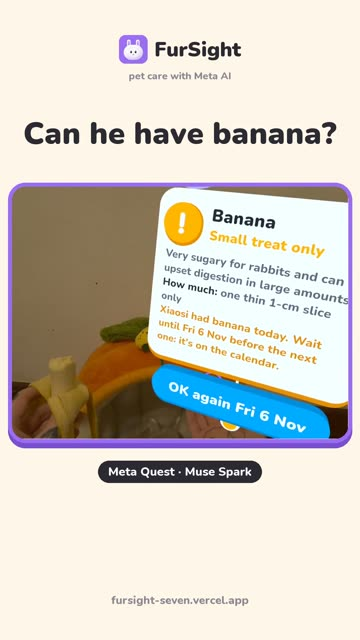](docs/videos/fursight-in-49-seconds.mp4) |
|:---:|:---:|:---:|
| **[How FurSight thinks](docs/videos/how-fursight-thinks.mp4)** (40 s): picture in, SAM 3.1 finds, Muse Spark decides, back to you | **[Meta's models at work](docs/videos/meta-models-at-work.mp4)** (33 s): what each model does, shot by shot | **[FurSight in 49 seconds](docs/videos/fursight-in-49-seconds.mp4)**: the highlights, for sharing |

## Meta Global AI Hackathon 2026

- **Track:** Indie Developer · **Problem statement:** Build for Your World
- **Built from scratch during the hackathon** (26 Oct to 4 Nov 2026): every line in this repo, first commit 27 Oct.
- **Meta models at runtime, all through the Meta Model API:**
  - **Muse Spark 1.3**, the agent: picks its own tools to answer (pet cams, find him, zoom, diary, litter tray, hay level, vet records, calendar) and checks every food verdict against the safety list before it answers.
  - **SAM 3.1**, the finder: outlines each hazard in a room check so Quest can pin a label on the real object, finds him across the pet cams, rings his droppings, and cuts out his stickers.
  - **Muse Voice Transcribe**, the ears: questions asked out loud on Quest and the phone.
- **Bonus categories:** Best Agentic Use-Case · Best Creative Build
- **Video:** [youtu.be/5Krj1QjiIVM](https://youtu.be/5Krj1QjiIVM) (2:57)
- **Install on Quest:** [FurSight-Quest.apk](https://github.com/ohistudio/fursight/releases/latest) (sideload, then link it to the demo rabbit with a code)
- **How to use it on each device:** [Try it on your device](#try-it-on-your-device), with pictures; the full guide is [docs/how-to-use.md](docs/how-to-use.md)
- **Try it with no key or login:** [fursight-seven.vercel.app](https://fursight-seven.vercel.app), press **Try it with a demo rabbit** (on an iPhone, open it in Safari: food, room and poo checks all work there). To run your own: [Quickstart](#quickstart).
- **Proof:** [food safety benchmark](docs/benchmark.md), 135 foods, zero toxic foods called safe; tests and benchmark run in CI on every push.

## Try it on your device

Every device shares one household. Start on the web, then link each other device by typing the 4-letter code it shows into the web app's **Devices** tab. Full guide: [docs/how-to-use.md](docs/how-to-use.md).

### On the web (start here, nothing to install)

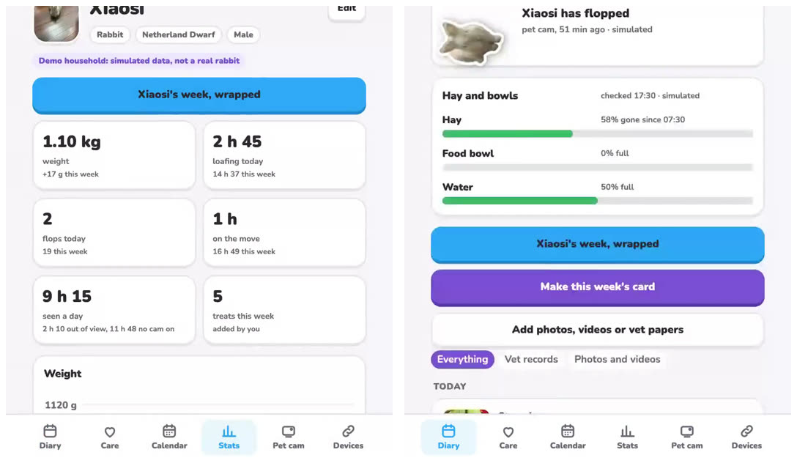

1. Open [fursight-seven.vercel.app](https://fursight-seven.vercel.app) and press **Try it with a demo rabbit**.
2. **Today**: press **Can he eat this?** for a food check, **Check the room for dangers**, or the poo check.
3. **Ask**: tap "How is he today?". Muse Spark finds him on the pet cams with SAM 3.1 and shows each step it took.
4. **Pet cam**: watch his three cams. **Stats**: his week in numbers.

### On your phone

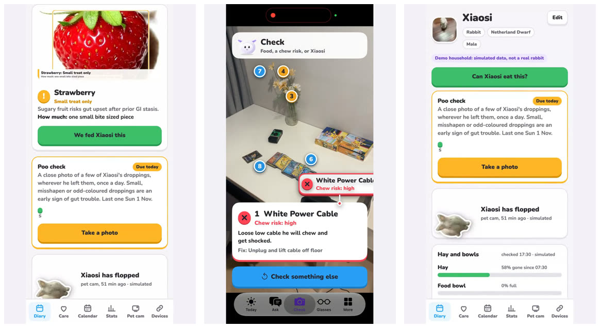

1. **Any phone:** open the web app in Safari or Chrome. Food, room and poo checks use the phone camera; nothing to install.
2. **iPhone app** (build it with Xcode, see [Quickstart](#quickstart)): it shows a code, type it into **Devices**.
3. **Check**: point at a plate, a food bag or a room. Each food gets a verdict; each hazard gets a numbered pin and how to fix it.
4. **Ask**: type or speak a question.

### On Meta Quest 3

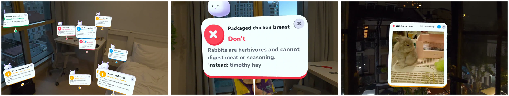

1. Download [FurSight-Quest.apk](https://github.com/ohistudio/fursight/releases/latest) and sideload it (Developer Mode, then Meta Quest Developer Hub, SideQuest or `adb install`). It's in Library > Unknown Sources.
2. Open it and type the code it shows into the web app's **Devices** tab.
3. **Turn your left palm towards you** to open the menu; poke a button.
4. **Check room**: look around and press. **Check food**: hold food up and press. **Ask**: press and speak. **Pet cam**: a window on his cams.

### On Meta Ray-Ban Display

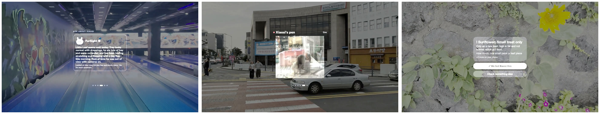

1. In the Meta AI app, turn on **Developer Mode** for your glasses.
2. **Web app**: open [fursight-seven.vercel.app/glasses/](https://fursight-seven.vercel.app/glasses/) on the glasses and type the code it shows into **Devices**. Swipe left and right for **Today**, **Pet cam**, **Care**, **Note**, **Ask** and **Diary**; press to choose.
3. **Glasses app** (food checks with the glasses camera, needs the iPhone app): in the iPhone app's **Glasses** tab, press **Connect to Meta AI**, then **Start glasses**. Look at food and press **Check**.

## What it does, on every device

- **Food check.** Hold food up to your glasses, Quest or phone: safe, a small treat or never, how much, and what instead. It reads labels and judges food as served (that salad dressing counts).
- **Room check.** Look round a room: every hazard he could chew, swallow or cut himself on is pinned on the real thing, the good things too. On Quest each hazard is saved as a **spatial anchor**: next time you open FurSight in that room, it asks if you fixed them.
- **Ask, wherever you are.** At the bowling alley or the traffic lights, ask your glasses how he is, or watch his pet cam. Muse Spark answers from his cams, his tray and his diary.
- **Three pet cams** watch him while you're not on your devices: SAM 3.1 finds him, Muse Spark notes how he rests, flops and eats his hay, and a flop sends you his sticker.
- **Poo check, vet papers, his week.** A photo of a few droppings is compared with the last check; a vet letter is read into his history; his week comes back as a Wrapped story and a card made of his real stickers.
- **Snap to make your own stickers** on Quest, with your real hands over every card through Meta's depth occlusion.

## Build for Your World

- **A problem I know firsthand.** A few months ago my rabbit, Xiaosi, got GI stasis: his gut stopped. Rabbits hide illness until it's serious, and since then every treat has felt like a risk.
- **Free up time and mental space.** Instead of watching him all day and second-guessing every treat, the pet cams and the FurSight Tray notice the small daily changes that come first (less hay, fewer tray visits, a dropping weight) and tell you when something's off. Treats are remembered, so you know if and when he can have the next one.
- **Something possible that wasn't before.** Hold a food up to your Ray-Ban Display and hear if he can have it. Ask your glasses what he's doing right now and get a sticker of him back. See verdict cards pinned to real food in Quest. A room that keeps an eye on his hay and tray for you.

FurSight is pet care: it never diagnoses. It notices changes and says when it's worth calling your vet, and the vet makes the calls.

## How it uses Meta's models

| Model | What it does in FurSight | Where |
|---|---|---|
| **Muse Spark** | Food verdicts as JSON (what, how safe, why, where, wait days); poses from the pet cam; hay and bowl levels; room checks; poo checks compared with the last one; vet papers read into his history; spoken notes sorted into the diary and calendar; weekly cards; and the Ask agent, which picks from 17 tools (find him, look through the cams, check his tray, read his calendar...) | [lib/meta.js](server/lib/meta.js) `spark()`, [lib/agent.js](server/lib/agent.js), [routes/food.js](server/routes/food.js), [routes/pose.js](server/routes/pose.js), [routes/levels.js](server/routes/levels.js), [routes/ask.js](server/routes/ask.js) |
| **SAM 3.1** | Finds him on each pet cam, cuts him out as stickers, measures the hay pile, outlines room hazards, rings his droppings for the poo check | [lib/sam.js](server/lib/sam.js), [routes/sticker.js](server/routes/sticker.js), [routes/room.js](server/routes/room.js) |
| **Muse Voice Transcribe** | Spoken questions and notes on Quest | [lib/meta.js](server/lib/meta.js) `transcribe()`, [routes/note.js](server/routes/note.js) |

### In pictures: every one is a real output

**SAM 3.1, the finder**

| | |
|---|---|
| 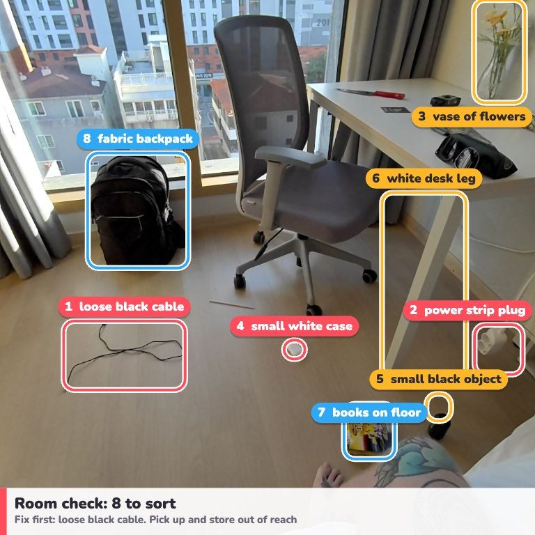 | 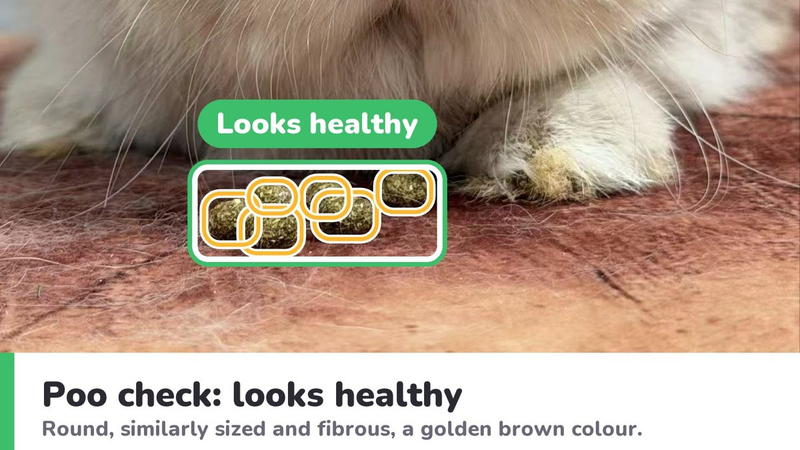 |
| **Room check.** Muse Spark names what he could chew; SAM outlines each one, numbered. | **Poo check.** SAM rings every dropping (it finds "small brown object", not "droppings"); Muse Spark judges them. |
| 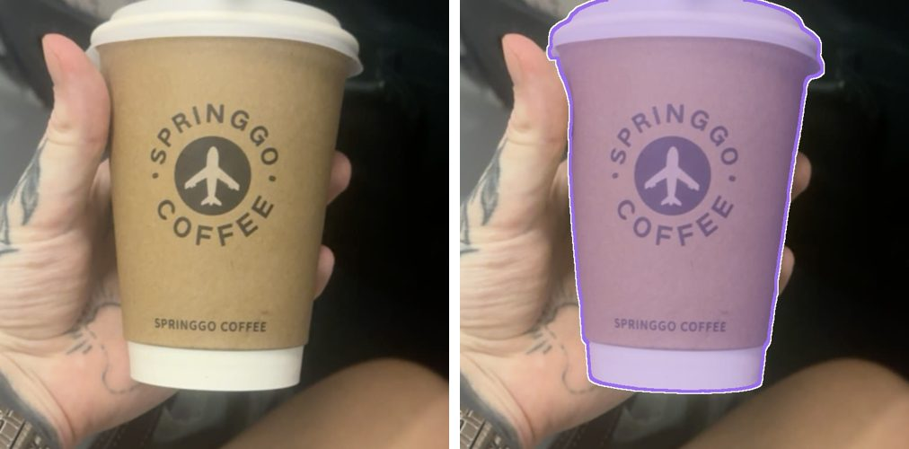 | 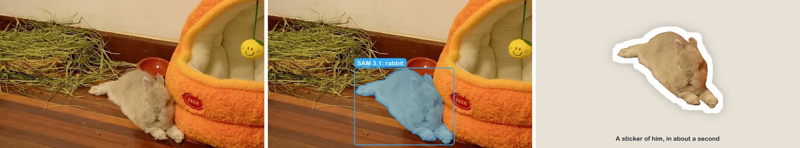 |
| **Food in hand.** SAM's mask on the cup, so Quest can pin the verdict to it. | **Stickers.** SAM finds him on the pet cam and cuts him out, in about a second. |

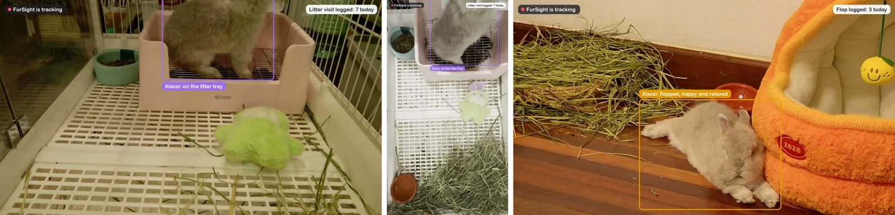

**Tracking on the pet cams.** SAM finds him a few times a second; the cam logs what he's doing (here a litter visit from two angles, and a flop).

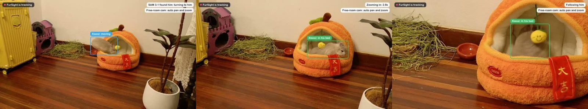

**The free-roam cam follows him.** SAM finds him, the OBSBOT Tiny 2 webcam turns and zooms in, then keeps him in frame.

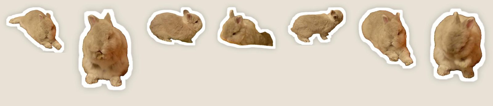

| | |
|---|---|
| 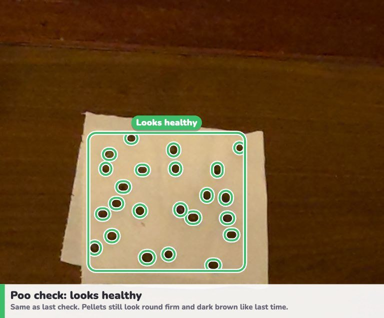 | 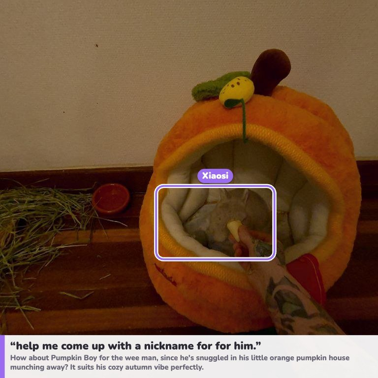 |
| **The picture each check saves.** On Quest you see dots on the droppings; the diary keeps the photo with SAM's rings on every one. | **What Ask looked at.** SAM found him in the photo; the answer and your question are saved with it. |

**Muse Spark, the agent**

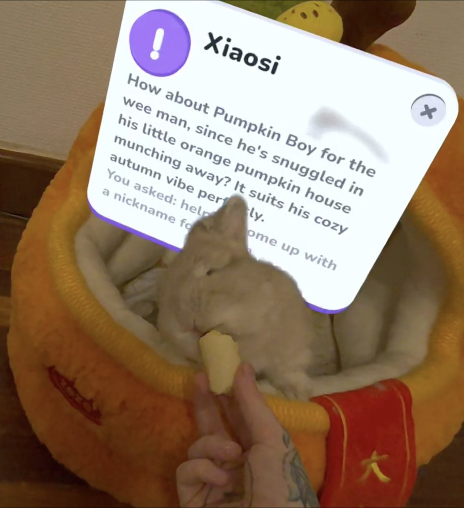

**Ask out loud, on Quest.** Asked for a new nickname, Muse Spark looked at him: "How about Pumpkin Boy… since he's snuggled in his little orange pumpkin house munching away?" He eats his banana in front of the card: depth occlusion keeps him on top.

| | |
|---|---|
| 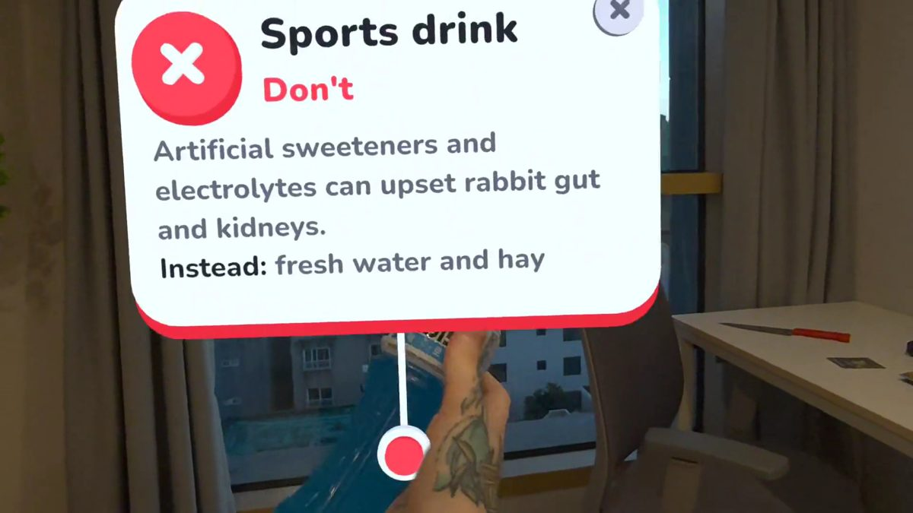 | 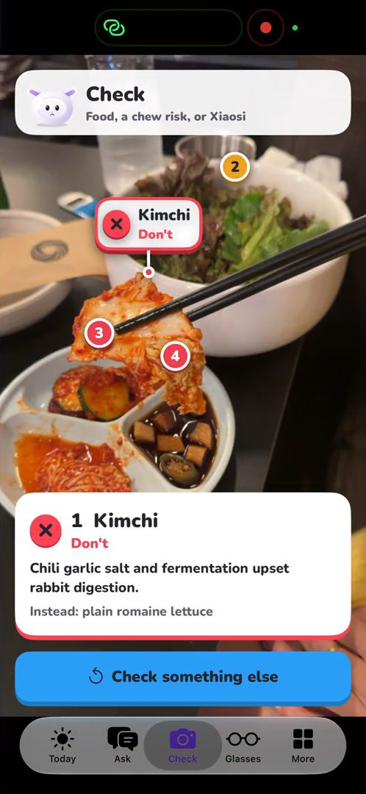 |
| **Food check on Quest.** The verdict, why, and what to give instead, pinned to the real bottle. | **Food check on the phone.** Every food on the plate gets its own verdict. |
| 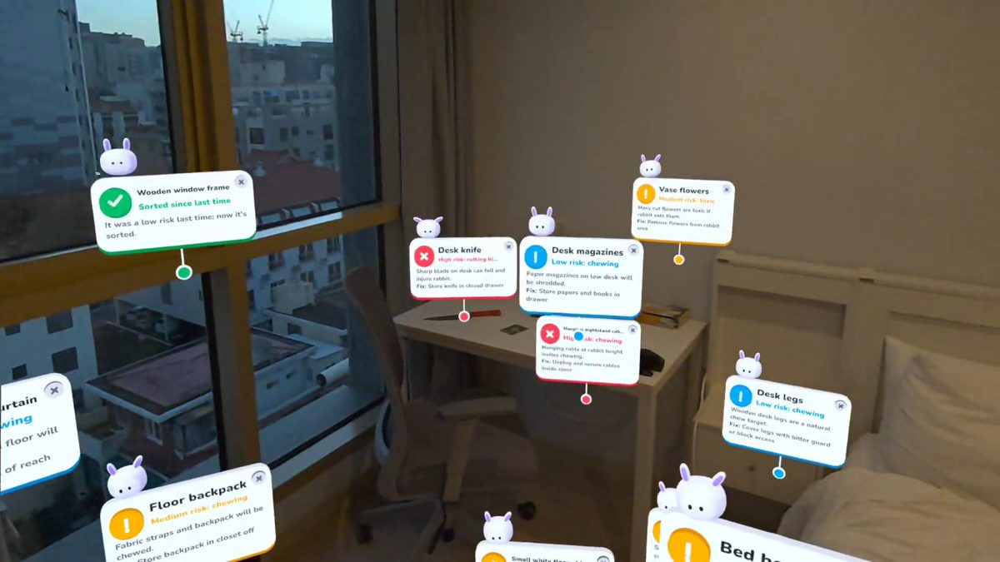 | 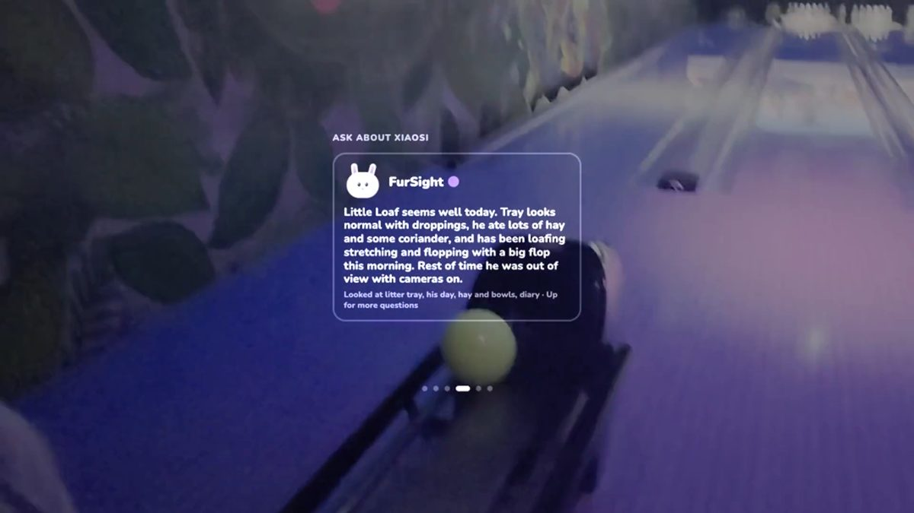 |
| **Room check on Quest.** Each hazard labelled where it really is, saved with spatial anchors. | **Ask on the glasses.** The agent checks the cams, his tray and diary, then answers. |
| 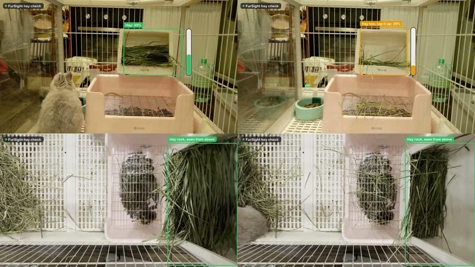 | 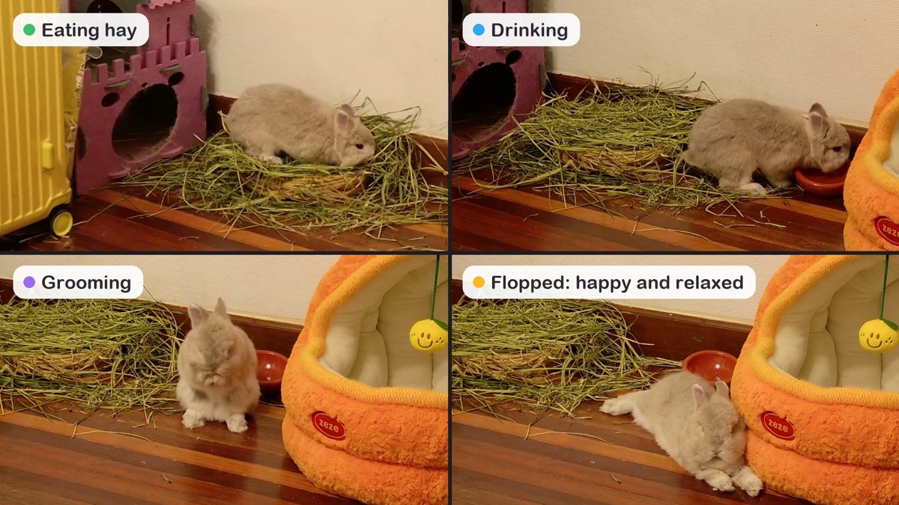 |
| **His hay.** Muse Spark reads the rack: 45%, then 20% and "top it up". | **His day.** What the free-roam cam logged: eating hay, drinking, grooming, a flop. |

## Food safety benchmark

Muse Spark's food verdict always passes through a rabbit safety list (RWAF and House Rabbit Society guidance) that can make it stricter, never softer. Tested on the worst case, the model wrongly saying "safe" to everything, over 135 foods:

| | Result |
|---|---|
| Toxic foods (82) | **82 of 82 caught as toxic** |
| Treat-only foods (27) | **27 of 27 kept off "safe"** |
| Safe foods (26) | **0 blocked as toxic** |

**Zero toxic foods called safe.** Details and how the first run found 14 gaps (now fixed): [docs/benchmark.md](docs/benchmark.md). It runs on every push (`npm test`; the 135 foods are in [`eval/`](eval/)).

**On real photos, end to end.** 41 openly licensed food and plant photos (Wikimedia Commons) through the live food check, Muse Spark and the safety list together:

| | Result |
|---|---|
| Toxic foods and plants (19) | **19 of 19 called "don't"** |
| Treat-only foods (12) | **12 of 12 kept off "safe"** |
| Safe foods (10) | **8 of 10 not blocked**: both misses were cautious (a single unidentified leaf, and celery juice in a celery photo) |
| Toxic called safe | **0** |

Every photo, what it saw and the credits: [docs/benchmark-photos.md](docs/benchmark-photos.md). Run it: `npm run bench:photos`.

**How long things take**, end to end against the live server (5 runs each, from China through a VPN; `npm run bench:latency`):

| Feature | Median | Slowest |
|---|---|---|
| Sticker (SAM 3.1 cut-out) | 1.1 s | 1.3 s |
| Ask, typed (Muse Spark agent) | 3.2 s | 3.4 s |
| Food check (Muse Spark + safety list) | 5.1 s | 6.9 s |
| Droppings check (SAM 3.1 + Muse Spark) | 7.2 s | 10.0 s |
| Room check (Muse Spark names, SAM 3.1 outlines) | 12.7 s | 14.0 s |

## How it's built

FurSight is one brain with two kinds of input: **passive** data from the cams and the Tray, collected all day while you're not looking, and **active** data from whatever device you pick up to check, ask or look.

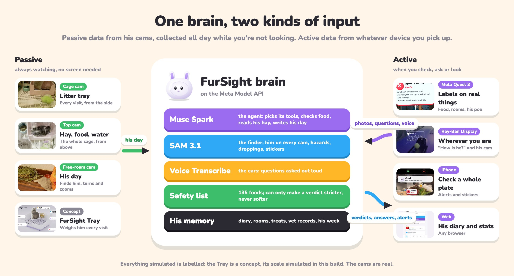

Under the hood: the brain is the FurSight API on Vercel (it holds the Meta key; no device ever sees it) calling the Meta Model API, plus a hub on Cloudflare Workers and Durable Objects for households, the diary and the pet cam relay. One household, every device: each device links with a 4-letter code and gets its own signed key (revoke a device and its key stops working).

**Hard problems, and what worked**

- **Labels on the real thing in Quest.** Muse Spark names each hazard with a short noun, SAM 3.1 outlines it in the passthrough camera frame, and the outline's centre goes through the camera's intrinsics into a Depth API raycast to land on the object in the room. Each label is saved as a spatial anchor, so next time FurSight asks "did you fix these from last time?" with a card on each one.
- **SAM can't find "rabbit droppings", but it can find "small brown object".** SAM 3.1 returned nothing for droppings, poop, pellet or dung; shape words found 33 of them in one photo. The poo check asks for the shape, and Muse Spark judges size and colour.
- **The model is never the last word on food.** Every verdict passes the safety list, which can only make it stricter, and the agent is told a diary food check is a check, never "he ate it" (it once told me to call the vet over a chocolate I had only checked).
- **Only hands and arms cover the labels.** Quest uses Meta's soft occlusion from the Depth API, gated to arm's reach, so your hand passes in front of a card but the room never hides it.
- **Pet cams that cost almost nothing.** The relay only carries frames while someone is watching, motion is spotted in the browser for free, and the AI is only asked once he's settled.

## Quickstart

No kit or rabbit needed to look around: open [fursight-seven.vercel.app](https://fursight-seven.vercel.app) and press **Try it with a demo rabbit**.

1. **Server** (the API, the web app at `/`, the glasses web app at `/glasses/`): copy `.env.example` to `server/.env.local` and fill in `MODEL_API_KEY` (from dev.meta.ai), `FURSIGHT_APP_TOKEN` (any long random string) and `HUB_KEY`. Then `npm run dev` serves it on http://localhost:3030. Deploy with `cd server && npx vercel --prod`.
2. **Hub and pet cam relay** (a Cloudflare Worker: households, devices, the diary, live cam frames): `cd cam && npm install`, put the same `HUB_KEY` in `cam/.dev.vars`, then `npm run dev` (local, port 8788) or `npm run deploy` with `npx wrangler secret put HUB_KEY`.
3. **iPhone** (Today, Ask, Check, the Ray-Ban Display app through the Wearables Device Access Toolkit): `cd ios && xcodegen generate`, open `FurSight.xcodeproj`, set your team and run on a phone. It links to your household with a 4-letter code (web app, Devices tab).
4. **Meta Quest 3**: open `quest/` in Unity 6000.3.17f1, create `Assets/FurSight/Resources/fursight_local.json` with `{"server": "<your server URL>", "token": "<FURSIGHT_APP_TOKEN>"}`, then build for Android. On launch it shows a code to link it.
5. **Ray-Ban Display**: the glasses web app at `/glasses/`, or the iPhone app's Glasses tab (Meta AI app, developer mode).
6. **Pet cams**: any webcam or old phone; open the web app's Pet cam tab and choose **Use this device as a pet cam**. Built and filmed with an **OBSBOT Tiny 2** (a pan, tilt and zoom webcam: FurSight's free-roam cam turns and zooms to follow him) and an iPhone above his cage.
7. **Tests and benchmark**: `npm test` (tests in [`tests/`](tests/)) and `npm run bench` (rebuilds [docs/benchmark.md](docs/benchmark.md) from [`eval/`](eval/)).

Or run the server in Docker: `docker build -t fursight .` then `docker run -p 3030:3030 -e MODEL_API_KEY=... -e FURSIGHT_APP_TOKEN=... -e HUB_KEY=... fursight`.

## What it is

A rabbit care kit and app: pet cams watch how he rests, flops and eats his hay, a smart litter tray weighs him and what he leaves, and the app turns it into a diary, alerts and a weekly card. Hold up food and ask if he can have it. Ask what he's doing right now. Look round the room and see what he'll chew.

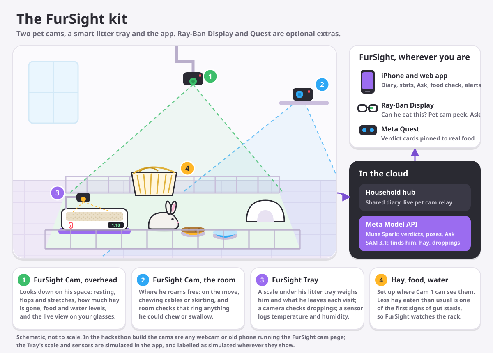

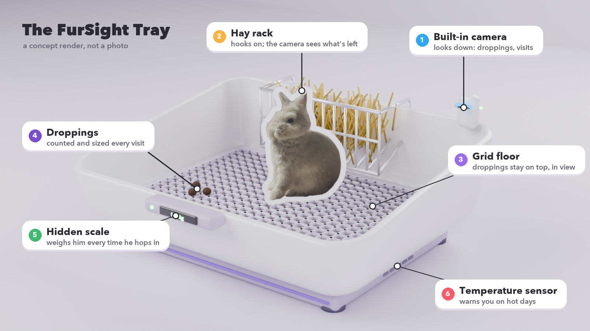

*The FurSight Tray, a concept render (not a photo).*

### As a product

| | Price | Cost to make |
|---|---|---|
| **The kit**: FurSight Tray + pen cam + pan-and-tilt cam, 3 months of Plus | **$249** | about $100 landed (about 50% gross margin sold direct) |
| FurSight Tray alone (scale, camera looking down, temperature and humidity) | $149 | about $42 |
| FurSight Cam: pen / pan and tilt | $59 / $69 | about $24 each |
| **Free** app: live view, weight and tray visits, diary, calendar, notes | $0 | almost nothing (no AI) |
| **FurSight Plus**: the AI (his day from the cams, hay and bowl checks, early warnings, food checks, Ask, stickers, Wrapped) | **$7.99 a month or $69 a year** | about $4 of AI a household a month with the on-cam model |

Rough numbers to show it holds up, not a business plan: [docs/product.md](docs/product.md).

### Beyond rabbits

The same kit fits any pet that lives in an enclosure and needs watching, especially the ones whose keepers already run thermometers, hygrometers and cams:

- **Reptiles**: basking and cool-side temperatures, UV lamp hours, humidity, shedding and feeding days, and which live food and greens are safe.
- **Amphibians**: water temperature and humidity, misting, and which live food is safe.
- **Guinea pigs, chinchillas and other small pets**: the same hay, tray and food checks with their own safety lists.
- **Cats and dogs**: free-roam cams that find them, food and plant checks, litter and walks.

Each species is one safety list ([server/lib/species/](server/lib/species/)) and a care plan; the cams, the Tray's sensors, the agent and every device stay the same.

More on the kit: [fursight-seven.vercel.app/kit](https://fursight-seven.vercel.app/kit/). As a product, with rough costs, the subscription and the AI per household: [docs/product.md](docs/product.md). Try it without the kit or a rabbit: open [fursight-seven.vercel.app](https://fursight-seven.vercel.app) and press **Try it with a demo rabbit**.

Built for the Meta Global AI Developer Hackathon (Indie track, Build for Your World).

Runs on the web, iPhone, Ray-Ban Display (a glasses web app, plus the iPhone app through the Wearables Device Access Toolkit) and Meta Quest.

In this hackathon build the FurSight Tray's scale and sensors are simulated in the app, and labelled as simulated wherever they show. The pet cams are real: any webcam or old phone running the cam page.
