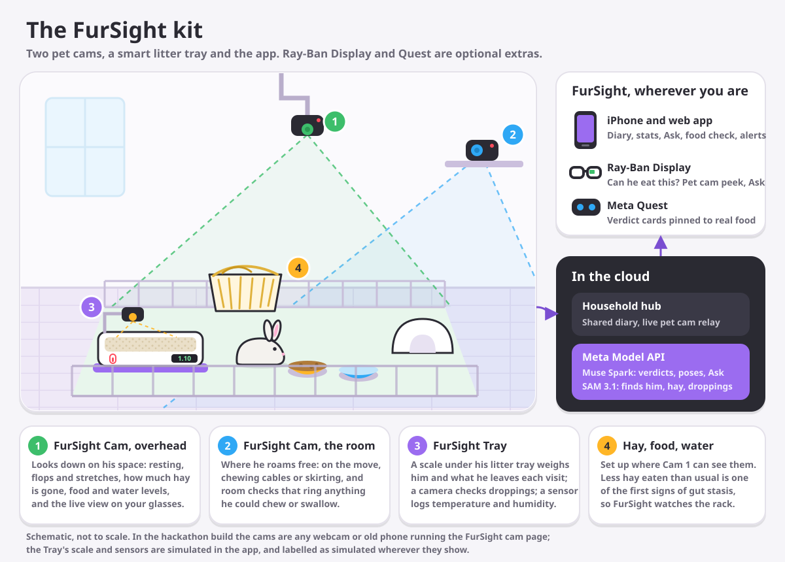
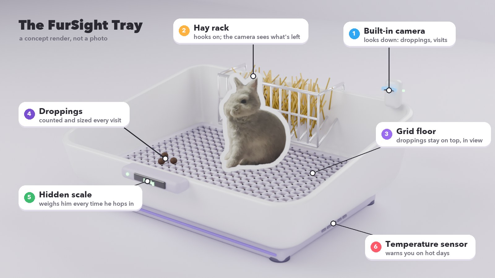

# FurSight

**Spoil them. Worry less.** Built on the Meta Model API: **Muse Spark**, **SAM 3.1**, **Muse Voice Transcribe** and **Muse Image**, on Ray-Ban Display, Meta Quest and iPhone.

Watch: [the intro](https://fursight-seven.vercel.app/intro/) · [how it uses Meta's models](https://fursight-seven.vercel.app/muse/) · [the kit](https://fursight-seven.vercel.app/kit/)

## Build for Your World

- **A problem I know firsthand.** A few months ago my rabbit, Xiaosi, got GI stasis: his gut stopped. Rabbits hide illness until it's serious, and since then every treat has felt like a risk.
- **Free up time and mental space.** Instead of watching him all day and second-guessing every treat, the pet cams and the FurSight Tray notice the small daily changes that come first (less hay, fewer tray visits, a dropping weight) and tell you when something's off. Treats are remembered, so you know if and when he can have the next one.
- **Something possible that wasn't before.** Hold a food up to your Ray-Ban Display and hear if he can have it. Ask your glasses what he's doing right now and get a sticker of him back. See verdict cards pinned to real food in Quest. A room that keeps an eye on his hay and tray for you.

FurSight is pet care: it never diagnoses. It notices changes and says when it's worth calling your vet, and the vet makes the calls.

## How it uses Meta's models

| Model | What it does in FurSight | Where |
|---|---|---|
| **Muse Spark** | Food verdicts as JSON (what, how safe, why, where, wait days); poses from the pet cam; hay and bowl levels; spoken notes sorted into the diary and calendar; weekly cards; and the Ask agent, which picks from 17 tools (find him, look through the cams, check his tray, read his calendar...) | [lib/meta.js](server/lib/meta.js) `spark()`, [lib/agent.js](server/lib/agent.js), [routes/food.js](server/routes/food.js), [routes/pose.js](server/routes/pose.js), [routes/levels.js](server/routes/levels.js), [routes/ask.js](server/routes/ask.js) |
| **SAM 3.1** | Finds him on each pet cam, cuts him out as stickers, measures the hay pile, outlines room hazards | [lib/sam.js](server/lib/sam.js), [routes/sticker.js](server/routes/sticker.js), [routes/room.js](server/routes/room.js) |
| **Muse Voice Transcribe** | Spoken questions and notes on Quest | [lib/meta.js](server/lib/meta.js) `transcribe()`, [routes/note.js](server/routes/note.js) |
| **Muse Image** | Redraws a photo of him for the weekly Wrapped poster | [lib/meta.js](server/lib/meta.js) `imageEdit()`, [routes/recap.js](server/routes/recap.js) |

## What it is

A rabbit care kit and app: pet cams watch how he rests, flops and eats his hay, a smart litter tray weighs him and what he leaves, and the app turns it into a diary, alerts and a weekly card. Hold up food and ask if he can have it. Ask what he's doing right now. Look round the room and see what he'll chew.

*The FurSight Tray, a concept render (not a photo).*

More on the kit: [fursight-seven.vercel.app/kit](https://fursight-seven.vercel.app/kit/). As a product, with rough costs, the subscription and the AI per household: [docs/product.md](docs/product.md). Try it without the kit or a rabbit: open [fursight-seven.vercel.app](https://fursight-seven.vercel.app) and press **Try it with a demo rabbit**.

Built for the Meta Global AI Developer Hackathon (Indie track, Build for Your World).

Runs on the web, iPhone, Ray-Ban Display (a glasses web app, plus the iPhone app through the Wearables Device Access Toolkit) and Meta Quest.

In this hackathon build the FurSight Tray's scale and sensors are simulated in the app, and labelled as simulated wherever they show. The pet cams are real: any webcam or old phone running the cam page.
